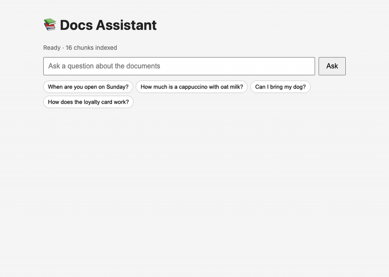
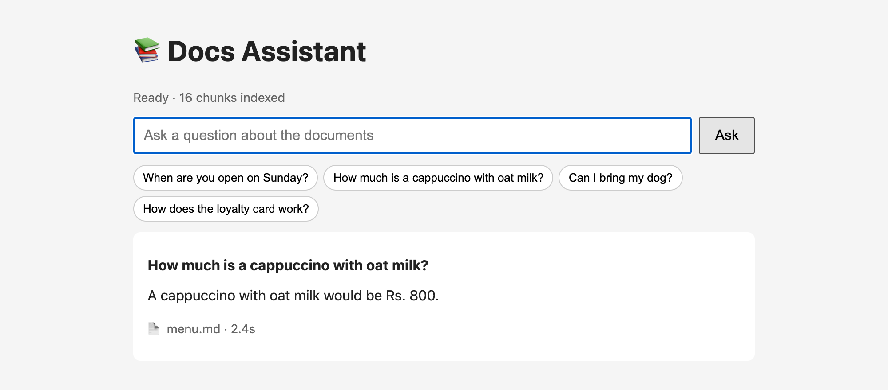

<div align="center">

# 30 Days of AI Engineering

**Learn AI engineering by building it yourself: LLM calls, tools, agents, embeddings, RAG and evals in plain TypeScript.**
<br>No LangChain. No API keys. No cloud bill. Everything runs on your laptop.

[](https://github.com/developerammar382/ai-engineering-journey/actions/workflows/ci.yml)
[](./LICENSE)


[](https://github.com/developerammar382/ai-engineering-journey/stargazers)



<sub>The final project: a RAG Docs Assistant with sources, built from scratch on Day 30.</sub>

</div>

---

Over 30 days I went from a single `chat()` call to a **RAG-powered Docs Assistant** with an HTTP API, a web UI, source citations, input guards and an automated eval suite. Every day is a small, runnable step with notes on what worked, what broke, and why.

```
Day 1                                                                    Day 30
  │                                                                         │
  ▼                                                                         ▼
messages[] → memory → streaming → JSON output → tools → tool loop → embeddings
→ vector store → chunking → RAG → HTTP API → web UI → agent → evals → Docs Assistant
```

**Status: ✅ all 30 days complete.**

---

## Quick start

```bash
git clone https://github.com/developerammar382/ai-engineering-journey.git
cd ai-engineering-journey
npm install

ollama pull qwen2.5:3b          # chat model (~2 GB)
ollama pull nomic-embed-text    # embedding model (~270 MB)

npm run doctor                  # checks Node, Ollama and models
npm run day -- 1                # run Day 1
```

New to Ollama? [Install it here](https://ollama.com). It runs open models on your own machine for free.

---

## Who this is for

- You know **basic JavaScript or TypeScript** and want to understand how AI apps actually work.
- You've used ChatGPT or an AI SDK, but RAG, tool calling and agents still feel like magic.
- You'd rather **build a vector store in 70 lines** than install one you don't understand.
- You have **30–60 minutes a day**. Each day is one small idea plus a "Try it yourself" exercise.

**How to follow along:** start at [Day 1](./day-01), read the day's README, run the code, then do the exercise before moving on. Share your solutions in [Discussions](https://github.com/developerammar382/ai-engineering-journey/discussions).

---

## Why build it this way

- **No LangChain, no vector DB.** I wrote the tool loop, cosine similarity, the vector store, the chunker and the RAG pipeline myself, so I know what those libraries actually do.
- **Local models only.** `qwen2.5:3b` for chat and `nomic-embed-text` for embeddings. Free, offline, and a small model shows failure modes that bigger models hide.
- **Measure, don't guess.** From Week 4 on, prompt changes are judged by eval scores, not by "looks better".
- **One folder per day.** Each day is a standalone snapshot. Shared code (like the vector store) is copied forward on purpose, so any day runs on its own.

---

## Roadmap

### Week 1 — LLM fundamentals

| Day | Topic | Key idea | |
| --- | --- | --- | --- |
| [01](./day-01) | Chat message structure | A conversation is just a typed array of `{ role, content }` | ✅ |
| [02](./day-02) | First call + memory | The model is stateless. The app owns the history | ✅ |
| [03](./day-03) | Terminal chatbot | `readline` loop over the chat API | ✅ |
| [04](./day-04) | Streaming + commands | `for await` over token chunks; `history` / `clear` | ✅ |
| [05](./day-05) | Prompt engineering | System prompts, few-shot, temperature 0 vs 1.2 | ✅ |
| [06](./day-06) | Structured output | JSON Schema via `format` instead of "please return JSON" | ✅ |
| [07](./day-07) | 🛠 File summarizer | CLI tool: `fs` + `argv` + streaming | ✅ |

### Week 2 — Tools, memory, reliability

| Day | Topic | Key idea | |
| --- | --- | --- | --- |
| [08](./day-08) | Tools by hand | LLMs can't do exact math; a sandboxed calculator (no `eval` on raw input) | ✅ |
| [09](./day-09) | Native tool calling | The model asks, the app runs the function, the result goes back | ✅ |
| [10](./day-10) | Multi-tool loop | Run tools until no `tool_calls` remain, with a max-steps guard | ✅ |
| [11](./day-11) | Persistent history | Chat state saved to disk after every turn | ✅ |
| [12](./day-12) | Context window | Trimming vs LLM summarization, measured with `prompt_eval_count` | ✅ |
| [13](./day-13) | Reliability | Timeouts, retry with backoff, runtime type guards | ✅ |
| [14](./day-14) | 🛠 Personal assistant | Tool loop + persistent notes + bounded history | ✅ |

### Week 3 — Embeddings & RAG

| Day | Topic | Key idea | |
| --- | --- | --- | --- |
| [15](./day-15) | Embeddings | Text → 768-dim vectors with `nomic-embed-text` | ✅ |
| [16](./day-16) | Semantic search | Cosine similarity from scratch; task prefixes improve ranking | ✅ |
| [17](./day-17) | Vector store | In-memory index + JSON persistence, top-k search | ✅ |
| [18](./day-18) | Chunking | Fixed-size with overlap vs paragraph splitting | ✅ |
| [19](./day-19) | RAG v1 | Retrieve → augment → generate over private docs | ✅ |
| [20](./day-20) | RAG v2 | Source citations, similarity threshold, grounded refusals | ✅ |
| [21](./day-21) | 🛠 Chat with your notes | RAG CLI over any folder (indexes this repo's READMEs by default) | ✅ |

### Week 4 — Shipping AI apps

| Day | Topic | Key idea | |
| --- | --- | --- | --- |
| [22](./day-22) | Raw REST API | `fetch` + NDJSON stream parsing: what the SDK does underneath | ✅ |
| [23](./day-23) | HTTP API | `node:http` server with input validation and proper status codes | ✅ |
| [24](./day-24) | Web chat UI | Token streaming to the browser; stateless server, client-side history | ✅ |
| [25](./day-25) | Agent | Goal-driven tool loop over files, least-privilege file access | ✅ |
| [26](./day-26) | Evals | Test set + scoring to compare prompt versions | ✅ |
| [27](./day-27) | Prompt injection | Delimiters, sandwich defense, input and output guards | ✅ |
| [28](./day-28) | 🏁 Docs Assistant: API | RAG behind `POST /ask` → `{ answer, sources }` | ✅ |
| [29](./day-29) | 🏁 Docs Assistant: UI | Vanilla HTML/JS frontend | ✅ |
| [30](./day-30) | 🏁 Docs Assistant: polish | Env config, eval suite, prompt fix driven by eval results | ✅ |

---

## Final project: Docs Assistant

Ask questions about any folder of Markdown or text files and get grounded answers with sources.



```
                ┌──────────── indexing (on startup) ────────────┐
 docs/*.md ──▶  chunk by paragraph ──▶ embed (nomic-embed-text) ──▶ vector store
                └───────────────────────────────────────────────┘
                                                                      │
 question ──▶ embed ──▶ top-k cosine search ──▶ filter score ≥ 0.55 ──┘
                                │
                     no chunks? → "couldn't find it" (no LLM call)
                                │
                      context + strict prompt ──▶ qwen2.5:3b ──▶ { answer, sources }
```

```bash
npx tsx day-30/server.ts                        # http://localhost:3000
DOCS_FOLDER=~/my-notes npx tsx day-30/server.ts # any folder
npx tsx day-30/eval.ts                          # run the eval suite
```

---

## What I found along the way

Real results from running the code, not theory:

| Experiment | Result | Takeaway |
| --- | --- | --- |
| Prompt versions on a support-ticket classifier (Day 26) | v1 **0%** → v2 **100%** → v3 **100%** | The model knew the answer in v1 but wrapped it in a sentence. Output format matters as much as content. |
| RAG eval on the Docs Assistant (Day 30) | **7/10 → 9/10** | Two "failures" were bad tests. One was a vague-answer bug fixed by a single prompt line. |
| Remaining RAG failure (Day 30) | Correct chunk not in top 6 | When retrieval misses, no prompt can save the answer. Next step: hybrid keyword + vector search. |
| `search_query:` / `search_document:` prefixes (Day 16) | Top match score **0.66 → 0.74**, better ranking | Read the embedding model's docs. Small details move retrieval quality. |
| Agent with write access to its inputs (Day 25) | Overwrote its own input files | Least privilege isn't optional for agents: read-only inputs, a separate output dir. |
| Prompt injection vs a "safe" prompt (Day 27) | 3B model still followed the injected text | Defenses reduce risk, they don't remove it. Never put secrets in prompts. |
| Tool calling with a 3B model (Days 9–10) | Mis-copied numbers, occasional empty replies | Log every tool call, and build fallbacks for model quirks. |

---

## Setup

Requires [Node.js](https://nodejs.org) 18+ and [Ollama](https://ollama.com).

```bash
ollama pull qwen2.5:3b          # chat model (~2 GB)
ollama pull nomic-embed-text    # embedding model (~270 MB)

npm install
npm run doctor                  # check everything is ready
npm run day -- 2                # run a day's main file
npm run day -- 6 structured-output   # run a specific file from a day
npx tsx day-02/chat.ts          # or run any file directly
npm run typecheck               # type-check the whole repo
```

Each day's README has its own run command and a "Try it yourself" exercise.

### Use a different model

Every day reads the model names from environment variables, so you can try a bigger (or smaller) model without editing code:

```bash
OLLAMA_MODEL=qwen2.5:7b npm run day -- 10
OLLAMA_MODEL=llama3.1:8b npx tsx day-30/eval.ts   # compare eval scores across models
EMBED_MODEL=mxbai-embed-large npm run day -- 21 --rebuild
```

| Variable       | Default            | Used for                         |
| -------------- | ------------------ | -------------------------------- |
| `OLLAMA_MODEL` | `qwen2.5:3b`       | Chat and tool calling            |
| `EMBED_MODEL`  | `nomic-embed-text` | Embeddings (Days 15–30)          |
| `DOCS_FOLDER`  | `day-30/docs`      | The folder Day 30 answers from   |
| `PORT`         | `3000`             | Day 30 server port               |

Pick a model that supports **tool calling** for Days 9–14 and 25.

All settings are listed in [`.env.example`](./.env.example). To use a file instead of inline variables (Node 20.6+):

```bash
cp .env.example .env
npx tsx --env-file=.env day-30/server.ts
```

### Troubleshooting

| Problem | Fix |
| --- | --- |
| `fetch failed` / `ECONNREFUSED 127.0.0.1:11434` | Ollama isn't running. Open the Ollama app or run `ollama serve`. |
| `model "..." not found` | Run `ollama pull <model>`. `npm run doctor` tells you which one. |
| Very slow answers | Normal on CPU-only machines. Use a smaller model, e.g. `OLLAMA_MODEL=qwen2.5:1.5b`. |
| Weird search results after changing `EMBED_MODEL` | Old vectors are cached in `store.json`. Delete it (or use `--rebuild` on Day 21). |
| Tool calls ignored or numbers mis-copied | That's a small-model quirk (see "What I found" above). Try a 7B+ model. |

---

## Tech stack

**TypeScript** · **Node.js** (`readline`, `fs`, `http`, `fetch`) · **Ollama** · `qwen2.5:3b` · `nomic-embed-text` · [`tsx`](https://github.com/privatenumber/tsx)

Only one runtime dependency: [`ollama`](https://www.npmjs.com/package/ollama).

---

## Contributing

Found a bug, a confusing explanation, or have an exercise idea? Issues and PRs are welcome. See [CONTRIBUTING.md](./CONTRIBUTING.md).

---

## License

[ISC](./LICENSE) © Ammar Shahid

---

## Author

**Ammar Shahid** · [ammarshahid.site](https://ammarshahid.site)

If this helped you learn something, a ⭐ is appreciated.
