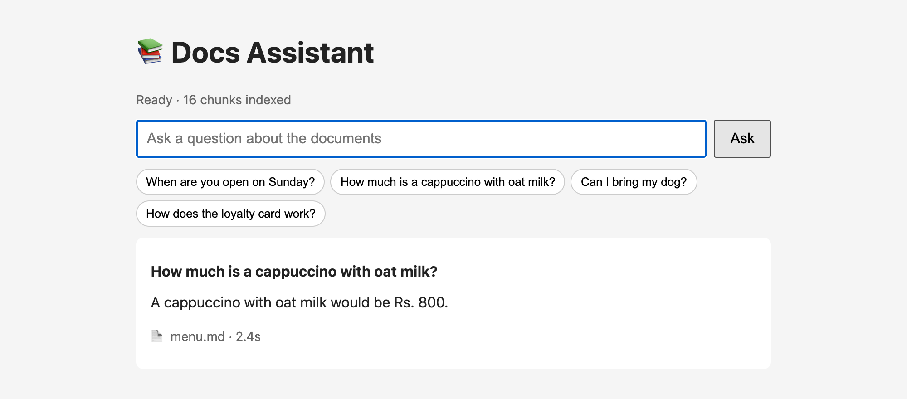

# Day 30 — 🏁 Final Project (3/3): Polish & Look Back

**Goal:** finish the Docs Assistant, and look back at the 30 days.



## What I added today

- **Settings via environment variables** (`config.ts`): point it at any folder.
  ```bash
  DOCS_FOLDER=~/my-notes PORT=4000 npx tsx day-30/server.ts
  ```
- **A nicer page:** example questions, a "Thinking..." state, error messages, response time.
- **An eval** (`eval.ts`, Day 26 idea): 10 test questions with words the answer must contain.
- **A prompt fix found by the eval:** answers were too vague ("The shop is in Lahore"), so I added "always include specific details like addresses, prices and times".

## Files

| File                | What it does                                |
| ------------------- | ------------------------------------------- |
| `server.ts`         | The server (now uses `config.ts`).          |
| `config.ts`         | `PORT` and `DOCS_FOLDER` from env vars.     |
| `eval.ts`           | Test questions + score.                     |
| `public/index.html` | The finished page.                          |
| `assistant.ts`      | RAG with sources + improved prompt.         |
| others              | Same as Day 29.                             |

## Run it

```bash
npx tsx day-30/server.ts     # open http://localhost:3000
npx tsx day-30/eval.ts       # run the tests
```

## Known issue (found by the eval)

"Where is the shop?" fails. The paragraph with the address doesn't even show up in the top search results, because the question is vague and "Our address is..." doesn't match it well. Ideas to fix it:

- Add a keyword search next to the vector search ("hybrid search").
- Add the section/heading name to each chunk, so chunks carry more context.
- Ask the AI to rewrite the question into a better search query first.

## Looking back at 30 days

| Week | What I can do now                                                                  |
| ---- | ---------------------------------------------------------------------------------- |
| 1    | Call an LLM, keep memory, stream answers, write good prompts, get JSON back.       |
| 2    | Give the AI tools, run a tool loop, save history, handle context limits and errors. |
| 3    | Embeddings, semantic search, a vector store, chunking, RAG with sources.           |
| 4    | Raw HTTP APIs, my own AI server and web page, agents, evals, and safety basics.    |

**Biggest lessons:**

1. The AI has no memory. **I** manage the messages.
2. Small models make mistakes, so **always log** tool calls and check outputs.
3. RAG quality depends mostly on **retrieval**. If the right chunk isn't found, the best prompt can't help.
4. **Evals** turn "I think it's better" into a number.
5. Give AI the **least power** it needs, and never trust text from outside.

## What's next

- Try a bigger model (`qwen2.5:7b`) and compare eval scores.
- Use a real vector database (e.g. Chroma or pgvector).
- Try a cloud API (OpenAI, Anthropic) with the same app.
- Build something real for myself with these pieces.
